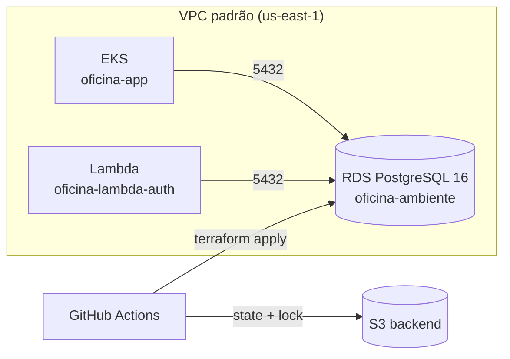

# oficina-infra-db

Infraestrutura do banco de dados gerenciado da **Oficina Mecânica** (FIAP 16SOAT — Tech Challenge Fase 3),
provisionada com Terraform: uma instância **Amazon RDS for PostgreSQL 16** por ambiente.

## Tecnologias

- Terraform `>= 1.10` e provider AWS `~> 5.80`
- Amazon RDS (PostgreSQL 16, `db.t3.micro`, storage `gp3` criptografado)
- State remoto em S3 com lock nativo (`use_lockfile`), sem DynamoDB
- GitHub Actions para validação, plan e apply

## Branches e ambientes

| Branch | Função | Ambiente / state |
|---|---|---|
| `main` | Integração. Protegida: merge somente via Pull Request. Em PR, roda `fmt`, `validate` e `plan` dos dois ambientes. | — |
| `homolog` | Deploy automático em homologação (`terraform apply`). | `envs/homolog.tfvars` → `oficina-infra-db/homolog/terraform.tfstate` |
| `production` | Deploy automático em produção (`terraform apply`). | `envs/production.tfvars` → `oficina-infra-db/production/terraform.tfstate` |

Fluxo: feature branch → PR para `main` (plan) → merge → PR `main` → `homolog` (apply em homologação) →
PR `homolog` → `production` (apply em produção).

## Recursos criados

| Recurso | Descrição |
|---|---|
| `aws_security_group` + regra de ingress | Libera a porta 5432 apenas para o CIDR da VPC (pods do EKS e Lambda). |
| `aws_db_subnet_group` | Subnets da VPC padrão. |
| `aws_db_instance` | PostgreSQL 16, privado (`publicly_accessible = false`), `oficina-<ambiente>`. |

Decisões específicas do AWS Academy / Learner Lab: usa a VPC padrão (compartilhada com o EKS e a Lambda), não cria
roles/IAM, e Multi-AZ fica desabilitado para reduzir custo.



## Variáveis

| Variável | Padrão | Descrição |
|---|---|---|
| `environment` | — | `homolog` ou `production` (definida em `envs/*.tfvars`). |
| `db_password` | — | **Sensível.** Vem de `TF_VAR_db_password`; nunca versionada. |
| `db_name` / `db_username` | `oficina` / `oficina_admin` | Database e usuário administrador. |
| `db_instance_class` | `db.t3.micro` | Classe da instância. |
| `backup_retention_period` | `1` (`7` em produção) | Dias de retenção de backup. |

Outputs relevantes: `db_endpoint`, `jdbc_url`, `reactive_url`, `vpc_id`, `subnet_ids`, `security_group_id`
(consumidos por `oficina-infra-k8s` e `oficina-lambda-auth`).

## Pré-requisitos (uma vez)

1. Criar manualmente um bucket S3 (nome único) para o state, com versionamento habilitado.
2. Criar os GitHub Environments `homolog` e `production` e configurar em cada um:
   - **Secrets**: `DB_PASSWORD` e, em `production`, `AWS_ACCESS_KEY_ID`, `AWS_SECRET_ACCESS_KEY`, `AWS_SESSION_TOKEN`. Homolog usa os secrets Organization `HOMOLOG_AWS_ACCESS_KEY_ID`, `HOMOLOG_AWS_SECRET_ACCESS_KEY` e `HOMOLOG_AWS_SESSION_TOKEN`, restritos aos quatro repositórios; expiram em ~4h.
   - **Variables**: `AWS_REGION` e `TF_STATE_BUCKET` já existem como variables da Organization. Variables de Environment com o mesmo nome têm precedência.
   - Configure as regras de aprovação do Environment conforme a política de promoção do time.

## Execução local

```shell
export AWS_ACCESS_KEY_ID=... AWS_SECRET_ACCESS_KEY=... AWS_SESSION_TOKEN=...
export TF_VAR_db_password='<senha>'

terraform init \
  -backend-config="bucket=<bucket>" \
  -backend-config="key=oficina-infra-db/homolog/terraform.tfstate" \
  -backend-config="region=us-east-1"
terraform plan -var-file=envs/homolog.tfvars
```

Para alternar de ambiente, rode `terraform init -reconfigure` com a `key` correspondente.

## Pipeline

`.github/workflows/terraform.yml`:

- **Pull Request**: `terraform fmt -check` e `validate` sem credenciais para todos os PRs. PRs de branches do mesmo repositório, abertos por `OWNER`, `MEMBER` ou `COLLABORATOR`, também executam `plan` para homolog e production, cada um com o Environment e state correspondentes; PRs de forks e autores sem associação confiável não recebem acesso AWS.
- **Push em `homolog`**: `terraform apply` com `envs/homolog.tfvars`.
- **Push em `production`**: `terraform apply` com `envs/production.tfvars`.
- **Execução manual**: `workflow_dispatch` reaplica o ambiente selecionado quando o workflow é iniciado na branch de mesmo nome, útil após renovar as credenciais temporárias do Learner Lab.

Se o lab for reiniciado, renove os secrets `HOMOLOG_AWS_*` da Organization e os `AWS_*` do Environment `production` antes de rodar as pipelines.

## Documentação relacionada

Swagger/Postman e demais diagramas ficam no repositório da aplicação (`oficina-app`).
